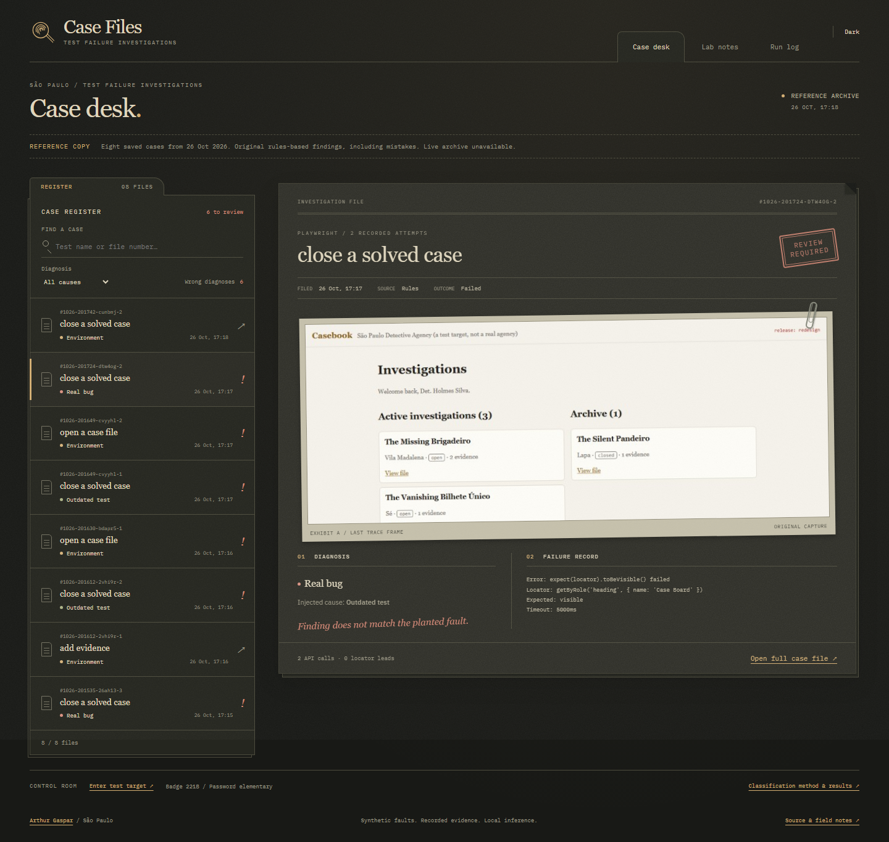
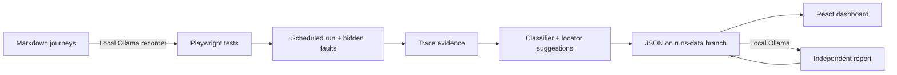

# Case Files

**A Playwright failure investigation lab, by Arthur Gaspar.**

[Open the dashboard](https://arthurgaspar.github.io/e2e-detective/) · [Explore the test target](https://arthurgaspar.github.io/e2e-detective/crime-scene/)



At Voidr, I worked on synthetic monitoring for critical user journeys. A failing test was the start of an investigation: read the trace, check the network, and decide whether the app, the infrastructure, or the test needed fixing. This project makes that workflow inspectable in a small public experiment.

The test target is a fictional São Paulo detective agency. Its missing brigadeiros and renamed case boards give the investigation a setting; the actual question is practical: **how much can observable evidence tell us about why a test failed?**

## Try it in two minutes

1. Open a case in the dashboard. Read the failed step, API timings, screenshot, and accessibility snapshot.
2. Compare the diagnosis with the known injected cause. Use **Wrong diagnoses** to inspect mistakes.
3. Open **Method & results** to inspect the confusion matrix, baselines, and feature weights.

The dashboard reads the `runs-data` branch. When that archive is unavailable, it uses eight bundled, explicitly labeled historical cases. They retain their original rules-based outputs, including errors. This curated selection is for inspection, not benchmarking; its provenance is in [`dashboard/public/sample/README.md`](dashboard/public/sample/README.md).

## What I built

- **Fault injection:** scheduled Playwright runs receive a per-test app release or network fault. Each failure has a known label, kept separate from model inputs.
- **Trace analysis:** errors, retries, API statuses and timings, console errors, a page snapshot, and the last screencast frame become a case file.
- **Failure classification:** multinomial logistic regression over 17 observable features, implemented in TypeScript and compared with deterministic rules and a majority baseline.
- **Local LLM tools:** Ollama writes independent reports, records tests from plain-language journeys, and proposes locator replacements. Each recorder action is checked against the live page before it is accepted.
- **Evidence browser:** a React dashboard with search, cause filters, wrong diagnoses, case details, evaluation results, and a run log.

## Results and their limits

The committed model was evaluated on 192 synthetic failures: 52 flaky, 49 environment, 26 app bugs, and 65 outdated tests.

| Method | Accuracy, 5-fold case-level cross-validation |
|---|---:|
| Logistic regression | 98.4% |
| Deterministic rules | 77.1% |
| Majority baseline | 33.9% |

Real-bug recall was 88.5% (23/26); the three missed bugs were classified as outdated tests. The full metrics and weights are committed in [`model/model.json`](model/model.json).

These scores are exploratory. The app is small, journeys repeat across folds, and features were refined after inspecting failures. They do **not** estimate production accuracy. A more convincing next evaluation would freeze the features and model, then test on another application or unseen fault families.

Reproduce the calculation without rewriting the model:

```sh
npm run evaluate -- --seed 1
```

This uses the bundled training records plus deduplicated labeled cases in `.runs-data/`, if present. For the committed dataset alone, use a nonexistent data directory: `npm run evaluate -- --seed 1 --data .scratch/no-cases`.

One instructive failure shaped the features: an incorrect counter and a renamed heading can both produce “element not found.” Checking whether a near match differs only by a number, whether the element is disabled, and whether the step is an assertion helps separate those causes. That improves this dataset; it also explains why feature tuning must be disclosed.

## Design decisions

**Evidence before generation.** The classifier uses observable trace and page information. The injected scenario is used for scoring, not prediction. The LLM sees neither ground truth nor the classifier’s answer, so its report can be compared independently.

**A small model first.** Logistic regression runs cheaply in CI and exposes its weights. LLM reports can help a person read a case, but a fluent explanation is not evidence of a correct diagnosis. Classifier scores are not calibrated probabilities; LLM confidence is self-reported.

**Suggestions require review.** Similarity-based locator ranking handles overlapping names such as “Add evidence” → “Log evidence.” Pure synonyms are harder. A plausible replacement can also hide a real app bug, so the heal command proposes a source change for human review and a test rerun.

**Static hosting, explicit tradeoffs.** GitHub Pages serves the UI and test target. Actions publishes JSON evidence to a data branch; Ollama runs locally. This avoids a hosted backend or paid inference dependency, at the cost of bounded retention (400 cases / 300 runs), Git history growth, and no production database or authentication.



## Run locally

Use Node.js 22 or later. Ollama is optional; archive browsing, tests, classification, and fault injection work without it.

```sh
npm ci
npx playwright install chromium
npm --prefix dashboard ci
npm --prefix dashboard run dev
```

Open the Vite address. The development server also serves `/crime-scene/` and the bundled model. With no local patrol data, the reference archive opens automatically. The fictional agency’s demo credentials are `221B` / `elementary`.

```sh
npm run test:e2e                       # journeys against the clean test target
npm run patrol -- --seed 42            # inject faults; save cases in .runs-data/
npm run patrol -- --scenario redesign  # force a specific release
npm run train                         # rewrite model/model.json using labeled cases
```

For local inference, install [Ollama](https://ollama.com) and pull `qwen2.5-coder:7b` (about 4.7 GB):

```sh
ollama pull qwen2.5-coder:7b
npm run investigate                          # reports for cases without one
npm run generate -- journeys/close-case.md    # record and verify a test
npm run heal -- <caseId>                      # edit a locator; review and rerun
```

Set `OLLAMA_MODEL` to choose another model. Recorded assertions may still be weaker than the journey intended; passing the recorder’s checks does not replace review.

## Validation and repository map

```sh
npm test
npm run typecheck
npm run test:e2e
npm run test:dashboard
npm --prefix dashboard run build
```

The deployment workflow checks agent tests, types, the dashboard build, and desktop/mobile browser flows. The browser tests exercise archive fallback, search, filters, evidence, deep links, theme persistence, and navigation.

| Directory | Responsibility |
|---|---|
| `agent/src/` | Evidence extraction, features, model, LLM tools, JSON storage, CLI |
| `agent/test/` | Classifier, recorder guards, locator logic, and summary regression tests |
| `tests/` | Playwright journeys and the fault-injection fixture |
| `crime-scene/` | Static test application with controlled buggy releases |
| `dashboard/` | React interface, reference evidence, and dashboard browser checks |
| `journeys/` | Inputs to the test recorder |
| `model/` | Labeled training evidence and the committed model |

The scheduled patrol runs every three hours. LLM commands run locally; this repository contains no employer code, client records, or production traces.
