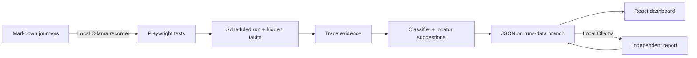

# Case Files

**A Playwright failure investigation lab, by Arthur Gaspar.**

[Open the dashboard](https://arthurgaspar.github.io/e2e-detective/) · [Explore the test target](https://arthurgaspar.github.io/e2e-detective/crime-scene/)


At Voidr, I worked on synthetic monitoring for critical user journeys. A failing test was the start of an investigation: read the trace, check the network, and decide whether the app, the infrastructure, or the test needed fixing. This project makes that workflow inspectable in a small public experiment.

The test target is a fictional São Paulo detective agency. Its missing brigadeiros and renamed case boards give the investigation a setting; the actual question is practical: **how much can observable evidence tell us about why a test failed?**

## Try it in two minutes

1. Select a file in the case register. The desk shows its recorded screenshot, failure, and diagnosis. Open the full file for API timings and the accessibility snapshot.
2. Compare the diagnosis with the known injected cause. Use **Wrong diagnoses** to inspect mistakes.
3. Open **Lab notes** to inspect the confusion matrix, baselines, and feature weights.

The dashboard reads the `runs-data` branch. When that archive is unavailable, it uses eight bundled, explicitly labeled historical cases. They retain their original rules-based outputs, including errors. This curated selection is for inspection, not benchmarking; its provenance is in [`dashboard/public/sample/README.md`](dashboard/public/sample/README.md).

## What I built

- **Fault injection:** scheduled Playwright runs receive a per-test app release or network fault. Each failure has a known label, kept separate from model inputs.
- **Case evidence:** errors, retries, API statuses and timings, console errors, a page snapshot, and a masked failure screenshot become a case file.
- **Failure classification:** multinomial logistic regression over 17 observable features, implemented in TypeScript and compared with deterministic rules and a majority baseline.
- **Local LLM tools:** Ollama writes independent reports, records tests from plain-language journeys, and proposes locator replacements. Each recorder action is checked against the live page before it is accepted.
- **Evidence browser:** a React dashboard with search, cause filters, wrong diagnoses, case details, evaluation results, and a run log.
- **External trace CLI:** offline analysis of an ordinary Playwright `trace.zip`, with JSON, Markdown and SARIF reports containing recorded evidence and suggestions for human review. An independent TodoMVC example demonstrates the workflow outside this lab.

## Results and their limits

The committed model was evaluated on 192 synthetic failures: 52 flaky, 49 environment, 26 app bugs, and 65 outdated tests.

| Method | Accuracy, 5-fold case-level cross-validation |
|---|---:|
| Logistic regression | 98.4% |
| Deterministic rules | 77.1% |
| Majority baseline | 33.9% |

Real-bug recall was 88.5% (23/26); the three missed bugs were classified as outdated tests. The full metrics and weights are committed in [`model/model.json`](model/model.json).

These scores are exploratory. The app is small, journeys repeat across folds, and features were refined after inspecting failures. They do **not** estimate production accuracy. A more convincing next evaluation would freeze the features and model, then test on another application or unseen fault families.

Reproduce the calculation without rewriting the model:

```sh
npm run evaluate -- --seed 1
```

This uses the bundled training records plus deduplicated labeled cases in `.runs-data/`, if present. For the committed dataset alone, use a nonexistent data directory: `npm run evaluate -- --seed 1 --data .scratch/no-cases`.

One instructive failure shaped the features: an incorrect counter and a renamed heading can both produce “element not found.” Checking whether a near match differs only by a number, whether the element is disabled, and whether the step is an assertion helps separate those causes. That improves this dataset; it also explains why feature tuning must be disclosed.

## Design decisions

**Evidence before generation.** The classifier uses observable trace and page information. The injected scenario is used for scoring, not prediction. The LLM sees neither ground truth nor the classifier’s answer, so its report can be compared independently.

**A small model first.** Logistic regression runs cheaply in CI and exposes its weights. LLM reports can help a person read a case, but a fluent explanation is not evidence of a correct diagnosis. Classifier scores are not calibrated probabilities; LLM confidence is self-reported.

**Suggestions require review.** Similarity-based locator ranking handles overlapping names such as “Add evidence” → “Log evidence.” Pure synonyms are harder. A plausible replacement can also hide a real app bug, so the heal command proposes a source change for human review and a test rerun.

**Static hosting, explicit tradeoffs.** GitHub Pages serves the UI and test target. Actions publishes JSON evidence to a data branch; Ollama runs locally. Storage defaults to JSON, with an optional MongoDB adapter. The archive has bounded retention (400 cases / 300 runs), Git history growth, and no dashboard authentication.



## Run locally

Use Node.js 22 or later. Ollama is optional; archive browsing, tests, classification, and fault injection work without it.

```sh
npm ci
npx playwright install chromium
npm --prefix dashboard ci
npm --prefix dashboard run dev
```

Open the Vite address. The development server also serves `/crime-scene/` and the bundled model. With no local patrol data, the reference archive opens automatically. The fictional agency’s demo credentials are `221B` / `elementary`.

```sh
npm run test:e2e                       # journeys against the clean test target
npm run patrol -- --seed 42            # inject faults; save cases in .runs-data/
npm run patrol -- --scenario redesign  # force a specific release
npm run train                         # rewrite model/model.json using labeled cases
```

For local inference, install [Ollama](https://ollama.com) and pull `qwen2.5-coder:7b` (about 4.7 GB):

```sh
ollama pull qwen2.5-coder:7b
npm run investigate                          # reports for cases without one
npm run generate -- journeys/close-case.md    # record and verify a test
npm run heal -- <caseId>                      # edit a locator; review and rerun
```

Set `OLLAMA_MODEL` to choose another model. Recorded assertions may still be weaker than the journey intended; passing the recorder’s checks does not replace review.

### Investigate with tools

```sh
ollama pull qwen3
npm run investigate -- --agent --model qwen3 --limit 3
```

Use an Ollama model that supports [tool calling](https://docs.ollama.com/capabilities/tool-calling). The agent investigates cases without reports using `get_error`, `list_network(status?)` (exact HTTP status, or `0` for requests without a response), `get_snapshot`, and `find_similar_locators`. It can call `rerun_test(locator)` once per case to try a recorded candidate in a temporary copy of the spec against the local crime scene with the recorded fault scenario. The rerun requires Playwright Chromium (`npx playwright install chromium`). A local result can differ from the original patrol when it ran against a deployed target.

`draft_issue` stores a title and Markdown body in the case JSON under `report.issueDraft` for review. It does not publish an issue.

### Optional MongoDB storage

Set `MONGODB_URI` to use MongoDB instead of local JSON as the source of cases and runs. Include a database name in the URI; otherwise the driver uses `test`. For example, in PowerShell:

```powershell
$env:MONGODB_URI = "mongodb://127.0.0.1:27017/e2e_detective"
npm run patrol -- --seed 42
npm run investigate
Remove-Item Env:MONGODB_URI  # return to JSON storage
```

The official `mongodb` driver is an optional dependency installed by `npm ci`; installations that omit optional dependencies need `npm install --include=optional` before enabling this adapter. With no URI (or an empty one), commands continue to use JSON. A configured MongoDB connection failure stops the command rather than silently switching storage. Connections close when commands finish, including after errors.

The adapter stores documents in `cases` and `runs`, and JPEG bytes in `screenshots` in the selected database. Each document/image must fit MongoDB's 16 MiB document limit. Saving a report preserves the original screenshot. Rebuilding the index after patrol or investigation keeps the latest 400 cases and 300 runs, removes expired screenshots, and exports JSON, images, and `index.json` into `--data` (default `.runs-data/`) for the existing static dashboard. That export replaces generated case/run files in the destination; use a dedicated directory. Existing JSON archives are not imported into MongoDB automatically. Training, evaluation, healing, and sweeps also select MongoDB when the URI is set; sweeps write their training records to `model/training.jsonl` as before.

For scheduled patrols, add a repository Actions secret named `MONGODB_URI`; the workflow already passes it to the patrol command. The database must be reachable from the runner. Without that secret, scheduled patrols keep using JSON. Database credentials remain on the agent side; the static dashboard reads only the exported archive.

## Data collection, retention, and LGPD

The lab collects evidence to diagnose Playwright failures and evaluate the classifier on synthetic test runs. This section describes the safeguards relevant to Brazil's **Lei Geral de Proteção de Dados Pessoais (LGPD, Law No. 13,709/2018)**, including data minimization, transparency, and security. [Article 6 and Article 46 of the LGPD](https://www2.camara.leg.br/legin/fed/lei/2018/lei-13709-14-agosto-2018-787077-publicacaooriginal-156201-pl.html).

### What a patrol collects

| Evidence | What the archive stores |
|---|---|
| Runs and tests | Target URL, timestamps, test names, outcomes, retries, durations, and injected scenarios. |
| Failed attempts | Error messages, failing locators, console errors, and API URLs, statuses, timings, and request failures. |
| Page and diagnosis | Accessibility snapshot text, a masked JPEG when available, classification features and verdicts, and locator suggestions. Optional Ollama reports and issue drafts are stored with the case. |

Managed patrols collect only network metadata as evidence. Request and response bodies and headers are excluded, and automatic Playwright traces are disabled. Stored URLs omit credentials, query strings and fragments. The redaction rules replace email addresses and CPFs that pass both check digits in console messages, snapshot text, errors, and locator candidates.

Patrols capture failure screenshots with Playwright masks over password, email, phone, autocomplete and free-text fields, plus elements marked with `data-private`. Mark any additional rendered personal data with `data-private`, including read-only content. Automatic failure screenshots and trace screencasts are disabled. When a masked capture is unavailable, the case has no screenshot.

### Retention

Local JSON storage defaults to `.runs-data/`. When patrol or investigation rebuilds the index, the active archive keeps the latest **400 cases and 300 runs** and removes screenshots associated with pruned cases. The MongoDB adapter applies the same limits and exports the retained archive as JSON and JPEG files. This is a count-based limit. Earlier copies can persist in Git history, backups, and the bundled historical sample.

Playwright can write temporary failure context and assertion output. Managed patrols attempt to remove the temporary run directory before saving cases, including on errors. An interrupted process can leave temporary files behind. Imported trace ZIPs and reports written by `analyze-trace` are outside the case archive's retention limits. The command leaves the input ZIP unchanged.

### What stays local and what is published

- **Offline trace analysis.** `analyze-trace` reads the input ZIP on the machine running the command. The command sends neither the original ZIP nor the generated report over the network. Managed patrols also keep their temporary Playwright reports and raw failure context on the machine or CI runner executing the tests.
- **Local inference by default.** Ollama receives prompts and applicable case evidence at `localhost:11434` by default. Setting `OLLAMA_URL` to a remote endpoint sends that input to the configured host. Issue drafts are saved with the case and require a separate action to publish as issues.
- **Configured services.** Playwright sends normal application traffic to the test target, which may be remote. If `MONGODB_URI` points to a remote database, stored cases, runs, and masked screenshots are sent to that database. The database credentials are used by the agent and excluded from the dashboard export.
- **Public CI output.** GitHub Actions runs scheduled patrols on a GitHub runner. It publishes the retained JSON archive and screenshots to the public `runs-data` branch. GitHub Pages serves the dashboard, including its bundled historical sample and the fictional test application. Local CLI runs require a separate action to publish files.

CI checks the complete Pages build and the retained `runs-data` export before publishing either. The check detects emails, valid CPFs, common Brazilian phone formats with a parenthesized area code, and populated personal fields or sensitive URL parameters. It uses Tesseract OCR for screenshots. Findings and unreadable or unsupported artifacts fail the job. Logs show the affected file without printing the matched value. Run the same check locally with `npm run check:publication -- dashboard/dist` and Tesseract on the PATH.

Redaction applies to newly collected evidence. Pattern matching and OCR have limited coverage, especially for personal data in free text and images. Use synthetic data for public patrols and review artifacts before sharing.

## Analyze a trace from another application

Capture a trace with Playwright Test, for example `npx playwright test --trace on`, then pass a single ZIP to the CLI. No JSON test report, lab fixtures, MongoDB, model training or Ollama is required. Analysis runs locally and does not contact the recorded application.

```sh
npm run analyze-trace -- path/to/trace.zip --output report.json
npm run analyze-trace -- path/to/trace.zip --format markdown --output report.md
npm run analyze-trace -- path/to/trace.zip --format sarif --output report.sarif
```

The default format is JSON. Omit `--output` to write to stdout; use `npm run --silent analyze-trace -- path/to/trace.zip` when piping JSON so npm's script banner is excluded. A successful analysis exits 0 even when it finds failures. Invalid arguments, missing/invalid archives, or write errors exit 1. Output directories are created automatically.

Reports include a SHA-256 fingerprint of the ZIP, the failing operation and locator where available, source file/line, error text, references to metadata entries and line numbers, network responses and console errors. The diagnoses distinguish assertion mismatches, unresolved locators, action readiness, network failures, HTTP errors, timeouts and unclassified failures. Network evidence covers all endpoint paths, not just `/api/`. HTTP failures remain separate observations rather than automatically being blamed for a failing test. Suggestions always require review; SARIF contains no automatic fixes.

These rules describe observable symptoms, not a proven root cause. A single trace cannot establish flakiness or reliably distinguish a wrong assertion from an application defect. The synthetic lab classifier is deliberately not applied to external traces. A trace with no recorded failure is labeled `no_failure_observed`, not “passed.” Prefer Playwright Test traces: library-only tracing can omit assertions and test-level failures. Trace metadata is an internal Playwright format, so malformed records produce warnings and unsupported/missing metadata may prevent analysis. ZIPs are read in memory without extraction, with limits of 32 MiB compressed and 128 MiB expanded metadata. Network-context URLs omit credentials, query strings and fragments; error text, console messages and source paths can still contain private information.

### Reproducible external proof

```sh
npx playwright install chromium
npm run proof:external
```

This visits the independent public [TodoMVC application](https://demo.playwright.dev/todomvc/), creates one task, and deliberately runs two incorrect tests. The wrapper checks that they fail for the intended reasons, diagnoses their ZIPs, checks the expected diagnoses, and writes all three formats to `.scratch/external-proof/reports/`. The wrapper exits 0 only when this proof succeeds; Playwright's two intentional failures appear in its output. Network or setup failures make the proof fail.

| External test | Observed evidence | Diagnosis |
|---|---|---|
| Incorrect task count | Expected `2 items left`, received `1 item left` | `assertion_mismatch` |
| Nonexistent archive button | Timed out waiting for `Archive tasks` | `locator_not_found` |

Captured ZIPs are committed as offline regression fixtures. The [example documentation](examples/external/README.md) links ready-to-read reports and records their provenance. `npm test` checks these captures and all three CLI output formats without contacting TodoMVC. This is evidence that ingestion and diagnosis work outside the original lab, not an accuracy benchmark on production failures.

## Validation and repository map

```sh
npm test
npm run typecheck
npm run test:e2e
npm run test:dashboard
npm --prefix dashboard run build
```

README screenshots use dark mode. With the dashboard development server running, `npm run screenshot` refreshes the image from the bundled reference archive.

The deployment workflow checks agent tests, types, the dashboard build, and desktop/mobile browser flows. The browser tests exercise archive fallback, search, filters, evidence, deep links, theme persistence, and navigation.

| Directory | Responsibility |
|---|---|
| `agent/src/` | Evidence extraction, features, model, LLM tools, JSON/MongoDB storage, CLI |
| `agent/test/` | Classifier, recorder guards, locator logic, and summary regression tests |
| `tests/` | Playwright journeys and the fault-injection fixture |
| `crime-scene/` | Static test application with controlled buggy releases |
| `dashboard/` | React interface, reference evidence, and dashboard browser checks |
| `journeys/` | Inputs to the test recorder |
| `model/` | Labeled training evidence and the committed model |

The scheduled patrol runs every three hours. LLM commands run locally; this repository contains no employer code, client records, or production traces.
