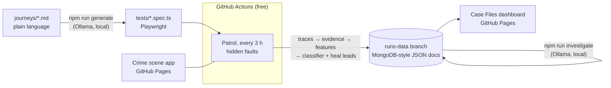

# Case Files: an AI detective for failing E2E tests

Every failing end-to-end test is a mystery. This project treats it like one: it collects evidence from Playwright traces,
questions the logs, names the suspects with a probability for each, and delivers a verdict. A local LLM writes the case
report and proposes fixes for broken locators.

**Live:** [Case Files dashboard](https://arthurgaspar.github.io/e2e-detective/) ·
[the crime scene](https://arthurgaspar.github.io/e2e-detective/crime-scene/) (the app under test)

## What it does

| Feature | How |
|---|---|
| **Records tests from plain language** | Describe a journey in a Markdown file. A local LLM plans it, drives a real browser one step at a time, and records a Playwright test. Every step is checked against the live page before it's kept. |
| **Patrols on a schedule** | Every 3 hours, GitHub Actions runs the journeys against the deployed app with a secretly injected fault per test: slow API, outage, dropped connections, buggy releases, or a redesign that renames buttons. |
| **Collects evidence** | For each failure: errors and retries from the Playwright report; API calls, statuses, timings and console errors from the `trace.zip`; an ARIA snapshot and the last screencast frame of the page. |
| **Names the culprit** | A classifier trained on past cases says whether the failure is **flaky**, **environment**, a **real bug**, or an **outdated test**, with confidence scores. |
| **Proposes heals** | When a locator finds nothing, similar elements on the page are ranked as likely replacements. `npm run heal` applies the best one to the spec. |
| **Writes the case report** | Locally, `npm run investigate` has the LLM read each case and independently write a verdict, a summary, the clues, a next step and (for outdated tests) a fixed locator. |
| **Keeps score** | The injected fault is stored with each case but hidden from the classifier and the LLM. The dashboard reveals it, so you can see how often the detective is right. |

## Results

Measured on 192 failures from 58 local patrols, each with a known injected cause (52 flaky, 49 environment, 26 real
bugs, 65 outdated tests).

| Judge | Accuracy |
|---|---|
| Classifier, 5-fold cross-validated | **98.4%** (real-bug recall 88%, all other causes 100%) |
| Hand-written rules (retry → flaky, 5xx → environment, …) | 77.1% |
| Always guessing the most common cause | 33.9% |

On 20 held-out cases (5 per cause) that neither model had seen, judged by all three:

| Judge | Correct |
|---|---|
| Classifier | 20 / 20 |
| LLM (qwen2.5-coder 7B via Ollama) | 17 / 20 |
| Hand-written rules | 14 / 20 |

What these numbers do and don't say:

- **The cheap classifier is the better judge.** The LLM's three misses were all the synonym rename
  "Case board" → "Investigations", which it called a real bug, at 100% self-reported confidence. Its value is the
  written explanation and, for renames that keep some words, a correct replacement locator.
- **The first model scored 86.5% and caught 0% of real bugs.** Real bugs here also show up as "element not found", so
  they looked like renames. Three clues a person would use fixed it: a near match that differs only by a number
  ("Closed cases (1)" instead of "(2)"), an element that's present but disabled, and whether the failing step was a
  check or an action.
- **98% is optimistic.** Those clues were designed after looking at this data's mistakes, and the crime scene is small
  and synthetic. Each scheduled patrol adds new labeled cases and retrains, so the published model card keeps
  measuring on data it wasn't tuned on.

The test recorder turned all four journeys in `journeys/` into passing tests with the 7B model. A 3B model could not:
it planned "sign in" as one step and declared journeys done after trivial checks.

## Architecture



Everything runs on free tiers: GitHub Pages hosts the dashboard and the crime scene; GitHub Actions runs the patrol; the
run and case documents live on a git branch, which the dashboard reads directly from `raw.githubusercontent.com`.
The LLM runs on your own machine with [Ollama](https://ollama.com), so no API key or paid service is involved.

## How it works

**The crime scene** (`crime-scene/`) is a small detective-agency app with no build step. `?release=` simulates deploying
a different build: three releases with real bugs, and a redesign that renames buttons, headings and test ids. Network
faults are injected separately by the test fixture at the network layer, the way a chaos proxy would.

**Evidence** (`agent/src/evidence.ts`) comes from the Playwright JSON report and each failed attempt's `trace.zip`, whose
newline-delimited JSON files hold the network log and console messages. Fields that exist only because a fault was
injected by the harness (such as `_wasFulfilled`) are deliberately ignored.

**The classifier** (`agent/src/model.ts`) is a multinomial logistic regression over 17 features, written in plain
TypeScript. Its weights read directly as "how much this clue points at this cause", which the dashboard shows. It is
always compared with the checklist a QA engineer would apply by hand. Every patrol retrains it on all labeled cases.

**Heal leads** (`agent/src/heal.ts`) rank the elements on the failing page against the broken locator by word and
character-trigram similarity plus role. That catches renames such as "Open case file" → "View file"; pure synonyms
such as "Case board" → "Investigations" get no lead, and in our evaluation the LLM missed them too.

**The interrogation** (`agent/src/investigate.ts`) gives the LLM a case brief: the key clues in plain words, errors, API
calls, console messages and the page snapshot. It does not show the classifier's verdict: in testing, the
model copied whatever answer it was shown, which made the "second opinion" worthless. Replies are validated
before they are stored.

**The test recorder** (`agent/src/generate.ts`) plans first, then acts. One call turns the journey into a checklist of
single actions and checks. For each item, the model sees the current ARIA snapshot and returns one action as JSON. The
agent rejects actions that match no element or several elements, actions of the wrong kind (a check answered with a
click), and actions that ignore values the journey names, and sends the reason back. The finished spec is then run
against the clean app.

## Run it locally

Needs Node 22+ and, for the LLM features, [Ollama](https://ollama.com) with `ollama pull qwen2.5-coder:7b`
(about 4.7 GB; it runs on an 8 GB GPU or on the CPU).

```bash
npm install
npx playwright install chromium

npm run test:e2e          # the journey tests against the clean app
npm run patrol            # one patrol with hidden faults; cases go to .runs-data/
npm run investigate       # LLM reports for cases without one
npm run generate -- journeys/close-case.md   # record a test from a journey
npm run heal -- <caseId>  # apply a case's best heal lead to its spec

cd dashboard && npm install && npm run dev   # dashboard over .runs-data/
```

To write reports for the live cases, check out the data branch (`git worktree add .runs-data runs-data`), run
`npm run investigate`, then commit and push from `.runs-data`.

`OLLAMA_MODEL` picks another model. The agent unloads the model after each command, so memory is only used while it works.

## Limitations

- The faults are simulated. Ground truth exists because the patrol plants it; that's what makes accuracy measurable,
  but real-world failures are messier.
- The classifier only knows the four causes it was trained on.
- Recorded tests should be reviewed. Their steps are checked against the page, but a check can be weaker than the
  journey intended (for example, a link that exists rather than a link in a specific column).
- The demo credentials (`221B` / `elementary`) are public on purpose; the crime scene has no real data.
