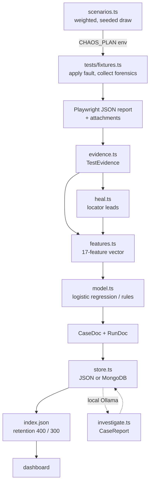

# Architecture

How a scheduled patrol turns a hidden fault into a published case file, and which module owns each step. For what the project is and why, see the [README](../README.md).

## 1. Drawing faults

`agent/src/scenarios.ts` defines every fault a patrol can inject. Each `Scenario` has an `id`, a ground-truth `cause` (`flaky`, `environment`, `real_bug`, `outdated_test`, or `null` for clean), a draw `weight`, and one mechanism:

| Mechanism | Scenarios | Implemented in |
|---|---|---|
| `release` | `bug-accuse`, `bug-evidence`, `bug-close`, `redesign` | `crime-scene/app.js`, which reads `sessionStorage.release` |
| `network` | `latency` (flaky), `outage` (503), `drop` (aborted) | `tests/fixtures.ts`, via `page.route("**/api/**")` |

`patrol()` in `agent/src/patrol.ts` lists tests with `playwright --list`. Then it draws one scenario per test from a mulberry32 PRNG seeded by `--seed`, so a plan can be reproduced exactly. `--scenario <id>` forces every test to one scenario, and `--faults-only` (used by `sweep`) excludes `clean`.

The plan reaches the test process as `CHAOS_PLAN`: JSON keyed by `testKey(file, title)` = `"close-case.spec.ts > close a solved case"`. Renaming a spec file or test title therefore changes its key.

## 2. Running tests and collecting forensics

Every spec imports `test`/`expect` from `tests/fixtures.ts`. Its `forensics` fixture is `auto`, so it wraps each test without being requested:

- **Before the test**, it applies the scenario's release (init script) or network route.
- **After a failure**, it attaches:
  - `masked-screenshot`: a JPEG from `captureMaskedScreenshot`, which masks password/email/tel/autocomplete inputs, textareas, and `[data-private]`;
  - `forensics`: JSON holding a redacted ARIA snapshot (max 4000 chars), interactive candidates (role, name, test id, tag), network metadata from `collect-network.ts`, and console errors.

`playwright.config.ts` keeps Playwright's own `trace` and `screenshot` options **off**, because those would capture unredacted bodies and pixels. Locally, `webServer` serves `crime-scene/` on `:4400`. In CI, `TARGET_URL` points at the deployed GitHub Pages copy.

Patrol output goes to a temporary `.patrol/<runId>/` directory, which is deleted in a `finally` block, even on errors.

## 3. Evidence and features

`evidence.ts` reads the JSON report and the attachments into `TestEvidence` (one entry per test, with one `AttemptEvidence` per retry). Errors are ANSI-stripped and redacted, and `locatorFromError` extracts the locator the failing step waited for. Harness-only markers such as `_wasFulfilled` are ignored on purpose, because they would reveal the injected fault.

`features.ts` converts evidence into a `FeatureInput` (outcome, per-attempt error/API/console, final snapshot, best heal lead), then into the `FEATURES` vector. Only `FeatureInput` is persisted, never the vector's provenance, and features are recomputed whenever data is read. This lets old cases and `model/training.jsonl` survive feature changes.

`heal.ts` ranks the page's candidates against the broken locator by trigram/word similarity and role, producing `HealLead`s. The best lead's score is the `heal_score` feature and feeds `near_match_differs_by_number` (for example `Closed cases (1)` vs. `(2)`, which indicates a real bug rather than a rename).

## 4. Classification

`model.ts` implements multinomial logistic regression with standardized inputs, batch gradient descent and L2 regularization. `model/model.json` stores `features`, `classes`, `mean`, `std`, `weights[class][feature]`, `bias`, and cross-validation `metrics`.

- With a model, `predict` returns per-cause scores (not calibrated probabilities) and the verdict is `by: "model"`.
- Without `model/model.json`, `rulesVerdict` decides (`by: "rules"`). The rules verdict is also stored on every case as a baseline.
- `evaluate` runs seeded 5-fold cross-validation and reports model, rules and majority accuracy.

Training samples are the union of `model/training.jsonl` and the store's labeled cases, deduplicated by case id.

| Command | Writes |
|---|---|
| `train` | `model/model.json` (committed) |
| `evaluate` | nothing; prints metrics |
| `sweep` | appends to `model/training.jsonl`; uses a throwaway `.sweep-data/` store |
| `patrol --retrain` | `<data>/model.json` (published), once there are ≥ 20 samples |

The dashboard loads `<data>/model.json` and falls back to the bundled `model/model.json`.

## 5. Storage and publication

`createStore()` returns a `MongoStore` when `MONGODB_URI` is non-empty, otherwise a `JsonStore`. Both implement `Store` (`saveRun`, `saveCase`, `getCase`, `listCases`, `rebuildIndex`, `close`). `rebuildIndex` drops everything beyond `KEEP_CASES = 400` / `KEEP_RUNS = 300` (sorted by `_id`, which starts with a timestamp) and writes `index.json`. The Mongo store then exports the same static layout into `--data`, because the dashboard only reads static files. Layouts are described in [data-format.md](data-format.md).

In CI (`.github/workflows/patrol.yml`), `--data` is a worktree of the orphan `runs-data` branch. After the patrol, `check:publication` scans the worktree (with Tesseract OCR for images), and only a clean result is committed and pushed.

## 6. LLM tooling (local, optional)

All LLM calls go through `llm.ts` to Ollama (`OLLAMA_URL`, default `localhost:11434`; `OLLAMA_MODEL`, default `qwen2.5-coder:7b`).

- `investigate.ts` writes a `CaseReport` from a plain-language brief of the evidence. The model sees neither `truth` nor the classifier's verdict, so its opinion stays independent. Replies are validated before storage.
- `investigate-agent.ts` (`--agent`) does the same with tool calling: `get_error`, `list_network`, `get_snapshot`, `find_similar_locators`, one `rerun_test` (via `investigation-rerun.ts`), and `draft_issue`, which only stores a draft in `report.issueDraft`.
- `generate.ts` turns `journeys/*.md` into `tests/generated/*.spec.ts`. It plans the steps, checks each action against the live crime scene, then runs the recorded spec.
- `heal.ts` / `heal` command replaces the broken locator in the spec with `report.fixedLocator` or the top heal lead, for human review.

## 7. Dashboard

`dashboard/` is a separate npm package (React 19 + Vite) that imports types from `agent/src` (`CaseDoc`, `Index`, `Model`, `Cause`). `src/data.ts` fetches `${VITE_DATA_URL}index.json`. If that fails, it falls back to `public/sample/`, eight labeled historical cases.

| Environment | `VITE_DATA_URL` / data source |
|---|---|
| Production | `https://raw.githubusercontent.com/<repo>/runs-data/` |
| `npm --prefix dashboard run dev` | `vite.config.ts` serves `/data/` from `../.runs-data` (`CASE_DATA_DIR` to override), plus `/crime-scene/` and `/model.json` |

`deploy.yml` builds the dashboard, copies `crime-scene/` to `dist/crime-scene/`, runs the dashboard Playwright checks and `check:publication`, then deploys to Pages. A successful deploy triggers a patrol.

## 8. External trace analysis

`analyze-trace.ts` is independent of everything above. It reads any Playwright `trace.zip` in memory with `fflate` (32 MiB compressed / 128 MiB expanded limits) and reports observable symptoms (`assertion_mismatch`, `locator_not_found`, network/HTTP failures, timeouts…) as JSON, Markdown or SARIF. It deliberately does not use the lab classifier, which was trained only on synthetic faults. Fixtures: `agent/test/fixtures/external/`, regenerated by `npm run proof:external` (see [examples/external](../examples/external/README.md)).
